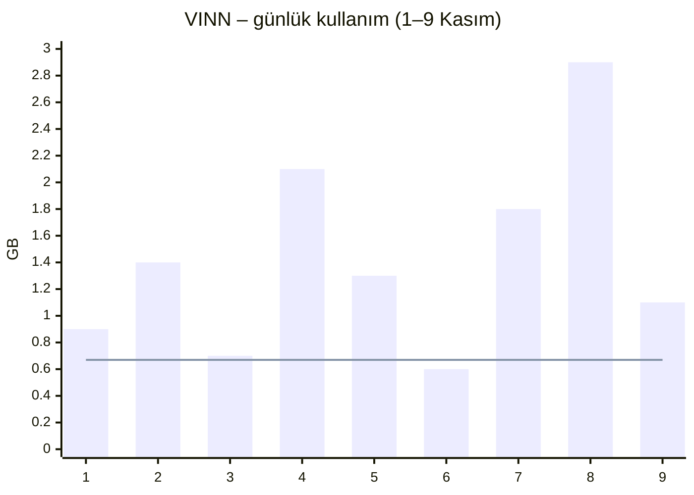
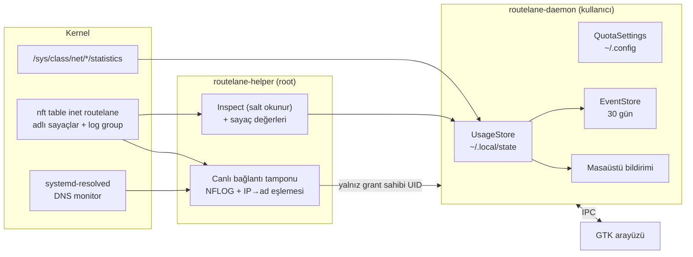

# Veri kullanımı, kota, canlı bağlantılar ve olay geçmişi

Tarih: 9 Kasım 2026.
Durum: Kullanıcı ekranları 9 Kasım'da tarayıcı taslaklarıyla tek tek onayladı ve
bağımsız okuma sonrası iki açık soruyu cevapladı; bu belge onay bekliyor. **Sıra kararı (kullanıcının):** önce yarım kalan seçici
yönlendirme işi (`docs/superpowers/plans/2026-10-22-selective-routing.md`) bitirilir,
bu özellik ondan sonra planlanır ve uygulanır.

## 1. Amaç ve kullanıcı anları

Kullanıcı üç anda RouteLane'den bilgi istiyor:

1. **Kotalı hatta geçtiğinde** (telefon hotspot'u, USB modem — örnekte VINN):
   “Ne kadar veri harcadım, kotam ne durumda?”
2. **Yeni bir URL ya da uygulama kuralı ekledikten sonra:** “Bu kural gerçekten
   çalışıyor mu, trafik doğru hattan çıkıyor mu?” Kullanıcı tarayıcıda/uygulamada
   eş zamanlı işlem yapıp, tarayıcıların Network paneli gibi satırların canlı
   akmasını görmek istiyor.
3. **Bir sorun olduğunu düşündüğünde:** “Ne oldu, ne zaman oldu?”

Başarı: kullanıcı bu üç soruyu terminal açmadan, birkaç tıklamayla ve teknik bilgi
gerektirmeden cevaplayabilir.

## 2. Kapsam

**Dahil:**

- **A — Hat başına kart toplamı:** her hattın ağ kartından geçen indirme/yükleme;
  günlük ve dönem toplamı; canlı hız.
- **B — RouteLane'in yönlendirdiği trafik:** hat başına, yalnız RouteLane'in o hatta
  yönlendirdiği indirme/yükleme; kural başına “son eşleşme” ve yeni bağlantı sayısı.
- **Kota:** hat başına isteğe bağlı aylık kota, uyarı ve bildirim.
- **Canlı bağlantılar:** kural, uygulama veya hat ayrıntısında, ekran açıkken eşleşen
  her **yeni** bağlantının satır olarak görünmesi (kaydedilmez), sunucu adıyla.
- **C1 — Olay geçmişi:** yedeğe geçiş/dönüş, profil uygulama/kapatma, hata ve
  geri alma, kural uygulama, kota eşikleri.

**Dahil değil (non-goals):**

- Bağlantı başına bayt miktarı (Linux bunu sistem geneli `nf_conntrack_acct`
  ayarıyla yapar; RouteLane genel sysctl değiştirmez).
- Tam URL/yol (HTTPS'te şifreli; RouteLane trafiği çözmez).
- Kalıcı bağlantı günlüğü (C2), dışa aktarma, telemetri.
- Kotada trafiği kesen/kısan koruma (ticari yol haritasındaki “kotalı hat koruması”
  ayrı bir iştir).
- Windows ve macOS (orada sayım, o platformların yönlendirme motorunun parçası
  olarak tasarlanır).
- **İleride yapılacak — Wi-Fi hotspot kotası:** telefonun Wi-Fi hotspot'una
  bilgisayarın Wi-Fi kartıyla bağlanıldığında kotanın kart yerine Wi-Fi ağına (SSID)
  bağlanması. Bu sürümde kota ve sayım **hatta, yani ağ kartına** bağlıdır; kotalı
  hattın ayrı bir cihaz (USB modem, USB tethering) olduğu varsayılır. Aynı Wi-Fi
  kartı evde de kullanılıyorsa ev trafiği de kotaya yazılır; kota penceresi bunu bir
  notla belirtir.

**Anti-goals (teknik olarak çalışsa bile başarısızlık sayılır):**

- Genel bir sysctl'i, yabancı nft tablolarını veya conntrack durumunu değiştirmek.
- Helper'a genel amaçlı komut/okuma yüzeyi açmak; makinedeki başka bir kullanıcının
  bağlantılarını göstermek.
- Kullanıcının bağlantı verisini diske yazmak ya da dışarı göndermek (canlı liste).
- Sayaç değerlerini “operatörün faturası” gibi kesin sunmak; trafik akışını “site
  çalışıyor” gibi sunmak.
- Seçici yönlendirme işiyle aynı anda protokol/journal değiştirmek.

## 3. Kullanıcının verdiği kararlar

- Örnek kota: VINN, **20 GB/ay, her ayın 1'inde** sıfırlanır.
- **Kotayı kartın toplam trafiği belirler** (operatör de öyle sayar); RouteLane'in
  yönlendirdiği kısım toplamın içinde ayrı bilgi olarak gösterilir.
- **Kotalı hat ayrı bir cihazdır** (kendi ağ arayüzü olan USB modem/tethering);
  Wi-Fi hotspot desteği ileride yapılacaklar listesindedir.
- **DNS izleme, profil etkin olduğu sürece açıktır** (sunucu adlarının çoğu görünsün
  diye); eşleme yalnız bellekte tutulur, profil kapatılınca silinir.
- **%80'de uyarı, dolunca bildirim.** RouteLane trafiği kesmez.
- **Kota girilmezse** uyarı yoktur; yalnız toplam indirme/yükleme gösterilir.
- Kuralın çalıştığını anlamak için **canlı yeni-bağlantı listesi yeterli**;
  bağlantı başına bayt gerekmez.
- Canlı listede **IP'nin yanında sunucu adı**, adın nereden geldiğini gösteren
  rozetle (DNS / kuraldan / bilinmiyor). Tam URL gösterilmez.
- Aşağıdaki ekranların tamamı onaylandı.

## 4. Ekranlar

Görsel taslaklar (yerel, git dışı):
`.superpowers/brainstorm/107405-1794210058/content/{connections-detail,rule-and-events,live-list-hostnames,quota-dialog}.html`.
Mevcut GTK4/Libadwaita yapısı korunur: üstte durum alanı, dört sekme (Genel Bakış,
Kurallar, Uygulamalar, Bağlantılar), boxed-list satırları. Tüm metinler TR/EN
(`src/ui/i18n.rs`). Grafikler `gtk::DrawingArea` + cairo ile çizilir; yeni bağımlılık
yok (benim kararım).

### 4.1 Bağlantılar listesi

```
┌ Bağlantılar ─────────────────────────────── [＋ Bağlantı Ekle] ┐
│ Ethernet  [Ana bağlantı]                                    › │
│ enp3s0 · Bugün ↓ 3,1 GB ↑ 420 MB                              │
├───────────────────────────────────────────────────────────────┤
│ VINN  [Kota %62]                                            › │
│ wwan0 · Bu dönem 12,4 / 20 GB                                 │
│ ████████████████░░░░░░│░░░░░   (│ = %80 eşiği)               │
├───────────────────────────────────────────────────────────────┤
│ Wi-Fi                                                       › │
│ wlp2s0 · Bağlı değil                                          │
└───────────────────────────────────────────────────────────────┘
```

Kotası olmayan hatta çubuk ve rozet yoktur; yalnız günlük ↓/↑.

### 4.2 Hat ayrıntısı (satıra tıklayınca)

```
‹ Bağlantılar                VINN                       [Düzenle]
┌ 12,4 GB / 20 GB kullanıldı · yaklaşık          [Kota ayarla] ┐
│ ████████████████░░░░░░│░░░░░                                  │
│ Kalan 7,6 GB · 1 Aralık'ta sıfırlanır · %80 uyarı             │
└───────────────────────────────────────────────────────────────┘
┌ ↓ İndirme (bu dönem) ──────┐ ┌ ↑ Yükleme (bu dönem) ─────────┐
│ 11,1 GB                    │ │ 1,3 GB                        │
│ RouteLane'in yönlendirdiği │ │ RouteLane'in yönlendirdiği    │
│ 8,7 GB                     │ │ 0,9 GB                        │
└────────────────────────────┘ └───────────────────────────────┘
┌ Günlük kullanım   [Bu dönem] [Son 7 gün] [Canlı hız]          ┐
│ (çubuk grafik; kotalı hatta “günlük ortalama sınır” çizgisi)  │
└───────────────────────────────────────────────────────────────┘
┌ Canlı bağlantılar ● dinleniyor · ↓ 1,8 MB/s ↑ 120 kB/s [Duraklat]
│ (bkz. 4.3 tablo düzeni; bu hatta çıkan tüm RouteLane bağlantıları)
└───────────────────────────────────────────────────────────────┘
```

Örnek “Bu dönem” grafiği (GB/gün):



Kararlarım: “Canlı hız” sekmesi son 60 saniyenin ↓/↑ çizgi grafiğidir (A
sayaçlarından); ortalamanın üstündeki gün vurgulanır; değerler “yaklaşık” etiketlidir.

### 4.3 Kural ve uygulama ayrıntısı

```
‹ Kurallar                 chatgpt.com                  [Düzenle]
┌ ✓ Çalışıyor — son 5 dakikada 14 yeni bağlantı VINN'den çıktı  ┐
│   Son eşleşme 3 sn önce · Hedef: domain · Eylem: VINN'e        │
└───────────────────────────────────────────────────────────────┘
┌ Canlı bağlantılar ● yalnız bu kural              [Duraklat]   ┐
│ Saat      Sunucu                     Adres                 Hat │
│ 14:32:05  chatgpt.com [DNS]          104.18.32.47:443 TCP VINN │
│ 14:31:58  cdn.oaistatic.com [DNS]    104.18.41.210:443 TCP VINN│
│ 14:31:40  chatgpt.com [kuraldan]     104.18.32.47:443 TCP VINN │
│ 14:31:12  bilinmiyor [—]             203.0.113.9:443 TCP  VINN │
└───────────────────────────────────────────────────────────────┘
┌ ⚠ Bu kuralın dışında kalan olabilir (yalnız domain kurallarında)┐
│ Domain kuralları yalnız tam adı kapsar; yönlendirme yapan      │
│ adresler (ör. releases.openai.com) ayrı kural ister.           │
└───────────────────────────────────────────────────────────────┘
```

Durum cümlesinin üç hali: **Çalışıyor** (son 5 dakikada eşleşme var), **Henüz
bağlantı yok** (profil etkin, eşleşme yok), **Hat kullanılamıyor** (kuralın hattı
hazır değil; fallback/engelleme politikası gösterilir). Uygulama ayrıntısı aynı
düzendedir (domain uyarısı yerine “yeni başlatılan pencereler/süreçler kapsanır” notu).
Liste en yeni satır üstte, en fazla 200 satır; ekran kapanınca silinir.

### 4.4 Genel Bakış kartları

- **Veri kullanımı (bu dönem):** kotalı hatlar çubukla, diğerleri ↓/↑ toplamla.
- **Son olaylar:** son 3 olay ve “Tümünü göster ›”.

### 4.5 Olay geçmişi sayfası

```
‹ Genel Bakış            Olay geçmişi                   [Temizle]
[Tümü] [Sorunlar] [Geçişler] [Kurallar] [Kota]
 (!) Yönlendirme uygulanamadı, önceki ayar geri yüklendi        ⌄
     Bugün 11:05 · Profil: Varsayılan
     └ DAEMON_RECONCILIATION_FAILED · … rollback: ok   (kopyalanabilir)
 (%) VINN kotasının %80'i kullanıldı — 16,0 / 20 GB
 (⇄) Ethernet kesildi, VINN'e geçildi — IPv4 ve IPv6
 (✓) Ethernet'e geri dönüldü — 7 dk yedekte, 410 MB
 (＋) “chatgpt.com” kuralı uygulandı
Son 30 gün saklanır, yalnız bu bilgisayarda.
```

### 4.6 Kota ayarla penceresi

Alanlar (hat ayrı bir cihaz varsayılır; Wi-Fi kartında “aynı kartla bağlandığınız
diğer ağlar da sayılır” notu görünür): “Kota sınırı kullan” anahtarı, aylık kota (GB),
yenilenme günü (1–31),
uyarı eşiği (%, varsayılan 80), “Bu dönem kullanılan” (elle düzeltme: operatörün
değeriyle eşitlemek için). İptal/Escape/kapatma yan etkisizdir; Kaydet doğrular.
Not satırı: “RouteLane trafiği kesmez… operatörün sayacıyla birebir tutmayabilir.”

### 4.7 Bildirimler

- Masaüstü bildirimi: “VINN kotasının %80'i doldu — 16,0 / 20 GB · 4 GB kaldı ·
  1 Aralık'ta yenilenir” ve “VINN kotası doldu — trafik kesilmedi; operatörünüz ek
  ücret alabilir.” Uygulama kapalıyken de gönderilir.
- Uygulama açıkken pencerenin altında kısa bildirim (toast) + “Ayrıntı”.
- Her eşik dönem başına bir kez; olay geçmişine de yazılır.

## 5. Mimari



### 5.1 A — Kart toplamları (daemon, root gerekmez)

- Kaynak: `/sys/class/net/<arayüz>/statistics/{rx_bytes,tx_bytes}` (ve ifindex).
- Örnekleme: hat ayrıntısı açıkken 1 sn (canlı hız), aksi halde 30 sn (benim kararım).
- Delta kuralı: sayaç azalırsa veya ifindex değişirse (yeniden başlatma, kart yeniden
  oluştu) yeni değer sıfırdan başlamış sayılır. Daemon çalışmadığı süre (kullanıcı
  oturumu kapalı) sayılamaz → değerler “yaklaşık”; elle düzeltme alanı bunu telafi eder.
- Hat ↔ arayüz: sayaçlar **lane id** ile tutulur; lane'in arayüz adı değişirse sayım
  lane üzerinden devam eder (benim kararım).

### 5.2 B — RouteLane'in yönlendirdiği trafik ve kural eşleşmeleri (helper)

- Renderer, RouteLane tablosuna **hat × yön** başına adlı sayaçlar ekler (yükleme:
  hattın işaretiyle çıkan paketler; indirme: o hattın dönüş yolu) ve explicit kuralların
  mevcut anonim sayaçlarını **kural başına adlı** sayaçlara çevirir. Kural sayaçları
  yalnız **yeni bağlantıyı** sayacak yere konur → “son eşleşme” ve yeni bağlantı
  sayısı için kullanılır, bayt için değil. (Not: bugünkü anonim explicit-kural
  sayaçları ct mark geri yüklemesinden önce eşleşen akışın her çıkış paketini sayıyor;
  bu varsayım mevcut kod için geçerli değil, yerleşim değişmelidir.)
- Okuma: `Inspect` değişmez (her yerel kullanıcı çağırabiliyor). Sayaç değerleri,
  canlı akış gibi **yalnız grant sahibi UID'ye açık** ayrı, salt okunur ve tipli bir
  helper metoduyla verilir; böylece grant sahibinin etkinlik zamanlaması başka
  hesaplardan okunamaz (benim kararım). Daemon 30 sn'de bir okur ve delta biriktirir.
- Parmak izi/mühür normalleştirmesi adlı sayaç nesnelerinin değerlerini de
  yok sayar (anonim sayaçlarda olduğu gibi).
- **Yükseltme şartı:** eski helper'ın uyguladığı (sayaçsız) plan, yeni helper'da
  “yabancı” sayılıp Degraded'a düşmemelidir. Çözüm yöntemi builder'a bırakılır
  (ör. journal'da renderer sürümü), ama bunu kanıtlayan test zorunludur.

### 5.3 Canlı bağlantılar ve sunucu adı (helper)

- Explicit kural eşleşmesine ve hat seçimine, **yalnız yeni bağlantının ilk
  paketinde** çalışan, hız sınırlı bir `log group` eklenir; önek kural/hat kimliğini
  taşır. Paket içeriği kopyalanmaz, yalnız başlıklar (adres, port, protokol).
- Helper NFLOG grubunu dinler, son N olayı bellekte tutar (diske yazmaz).
- Sunucu adı kaynakları, öncelik sırasıyla:
  1. **DNS:** systemd-resolved sorgu izleme arayüzünden IP→ad eşlemesi (TTL'li,
     sınırlı bellek). Kullanıcının kararıyla izleme **profil etkin olduğu sürece**
     açıktır (yalnız canlı ekran açıkken açmak, tarayıcı adları önceden çözdüğü için
     çoğu satırı “bilinmiyor” bırakırdı). Eşleme diske yazılmaz ve profil
     kapatılınca/helper durunca silinir. systemd-resolved yoksa veya izleme arayüzü
     desteklenmiyorsa (ör. eski systemd) bu kaynak devre dışı kalır.
  2. **kuraldan:** IP, domain kuralının çözümlenmiş adreslerinden biriyse.
  3. **bilinmiyor.**
- Erişim: akışı yalnız etkin runtime grant'in sahibi UID okuyabilir (Polkit sorusu
  yok); grant yoksa canlı liste boş ve “profil etkin değil” der.
- Kimin bağlantıları: RouteLane kuralları makinedeki tüm trafiğe uygulanır. Liste
  grant sahibinin kendi bağlantılarını ve sistem servislerinin (root/sistem
  kullanıcıları) bağlantılarını “sistem” etiketiyle gösterir; **başka bir oturum
  açmış kullanıcının** bağlantıları gösterilmez, yalnız “N bağlantı başka bir
  kullanıcıya ait” sayısı görünür. UID bilgisi NFLOG'dan alınır; alınamayan satır
  “sistem” değil “bilinmiyor” etiketlenir (benim kararım). Kural sayaçları herkesi
  sayar; kural ayrıntısındaki sayı “tüm kullanıcılar” diye etiketlenir. Daemon, ekran açıkken 1 sn'de bir
  imleçli (cursor) toplu okuma yapar; ekran kapanınca durur. Taşmada “N satır atlandı”.

### 5.4 Kota (daemon)

- `QuotaSettings` (`~/.config/routelane/usage-settings.json`, 0600, sürümlü): lane id
  başına `{enabled, limit_bytes, reset_day, warn_percent}`. Config şeması (v4)
  değişmez (benim kararım: seçici yönlendirme işiyle çakışmasın diye).
- Dönem: `reset_day` günü 00:00 yerel saat; ayda o gün yoksa ayın son günü.
- Birim: GB = 10⁹ bayt (operatörlerle uyumlu; benim kararım), bir ondalık.
- Kullanılan = dönemdeki **A** toplamı (↓+↑) + elle düzeltme farkı.
- Eşikler dönem başına bir kez tetiklenir; durum `UsageStore`'da saklanır.

### 5.5 C1 — Olay geçmişi (daemon)

- `EventStore` (`~/.local/state/routelane/events-v1.jsonl`, 0600): 30 gün ve en fazla
  5.000 kayıt (benim kararım); “Temizle” hepsini siler.
- Olay türleri: profil uygulandı/kapatıldı; uygulama başarısız (kod, mesaj, geri alma
  sonucu); kural uygulandı (önceki planla farktan); yedeğe geçiş (kaynak, hedef,
  aileler); geri dönüş (yedekte kalınan süre, yedek hatta o sürede A toplamı);
  NeedsReauthorization/Degraded; kota %eşik; kota doldu.
- Kaynak: daemon'un zaten işlediği apply sonuçları ve `RuntimeChanged`/durum
  değişiklikleri. Helper journal'ı okunmaz.

### 5.6 Bildirim

- Daemon, oturum D-Bus'ı üzerinden masaüstü bildirimi gönderir (UI kapalıyken de).
- UI açıkken yalnız toast gösterir; çift masaüstü bildirimi olmaz.

### 5.7 IPC ve protokol

- Daemon IPC'ye: kullanım özeti/geçmişi alma, kota ayarı kaydetme, elle düzeltme,
  olayları listeleme/temizleme, canlı bağlantı akışını başlatma/okuma/durdurma.
- Helper'a: grant sahibine açık, salt okunur sayaç okuma metodu ve canlı bağlantı
  okuma metodu; `Inspect` değişmez.
- Protokol sürümleri seçici yönlendirmenin getirdiği sürümlerin **üzerine** artırılır;
  eski peer ile uyuşmazlık mutasyondan önce anlaşılır bir hata verir.

## 6. Güvenlik ve gizlilik

- Yalnız RouteLane'e ait `inet routelane` tablosuna sayaç ve log kuralı eklenir;
  genel sysctl, yabancı tablo, conntrack durumu değiştirilmez.
- Helper'a eklenen her şey salt okunur ve tiplidir; keyfi komut/yol kabul edilmez.
- Canlı liste ve DNS ad eşlemesi yalnız bellekte; profil kapatılınca silinir.
  Olaylar ve sayaçlar 0600 dosyalarda, makine dışına çıkmaz. Olay kayıtlarında
  bağlantı adresi tutulmaz. DNS izlemesinin açık olduğu, profil etkinleştirme
  açıklamasında ve canlı liste ekranında tek cümleyle belirtilir.
- Metinler dürüst: “yaklaşık”, “RouteLane'in yönlendirdiği”, “trafik kesilmedi”;
  sağlık ekranı ile trafik bilgisi karıştırılmaz.

## 7. Kabul ve test

- **Rootless:** delta/reset ve ifindex değişimi; dönem sınırları (29–31, şubat);
  eşiklerin dönem başına bir kez tetiklenmesi; elle düzeltme; olay saklama ve sınır;
  TR/EN metinler; IPC sözleşmeleri; UI modellerinin boş/kotasız/kotalı halleri.
- **Sözleşme:** adlı sayaç ve log kurallı nft dokümanı; parmak izi normalleştirmesi;
  eski helper planının yükseltmede Degraded'a düşmemesi; sayaç ve canlı akış
  metotlarının yalnız grant sahibine açık olması; başka bir kullanıcının
  bağlantılarının listede görünmemesi.
- **Kernel (yetkili tek kullanımlık VM):** doğru hat ve yönde sayaç artışı; doğru
  kurala ait log olayları; resolved varken ad eşlemesi, yokken geri düşüş; profil
  kapatılınca ad eşlemesinin silinmesi; yabancı nft/route/sysctl sentinel'lerinin
  değişmemesi.
- **GTK smoke:** tüm ekranlar ve grafikler boş/kotasız/kotalı veriyle açılır; kota
  penceresinde İptal/Escape yan etkisiz, çift Kaydet tek işlem.

## 8. Efor (tek geliştirici, test dahil, tahmini)

| Parça | Süre |
|---|---|
| A + kota + bildirim | ~1 hafta |
| B (adlı sayaçlar, Inspect, yükseltme şartı, kernel testleri) | ~2 hafta |
| C1 olay geçmişi | ~1 hafta |
| Canlı bağlantılar + sunucu adı | ~2 hafta |
| Ekranlar ve grafikler | yukarıdakilerle paralel |
| **Toplam** | **~6–7 hafta** |

## 9. Builder'a bırakılanlar

Tam nft kural yerleşimi, örnekleme aralıklarının ince ayarı, grafik çizim
ayrıntıları, dosya formatlarının alanları, yükseltme uyumluluğunun yöntemi
(test şartı bağlayıcıdır), canlı akış tampon boyutları.
